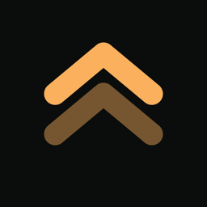
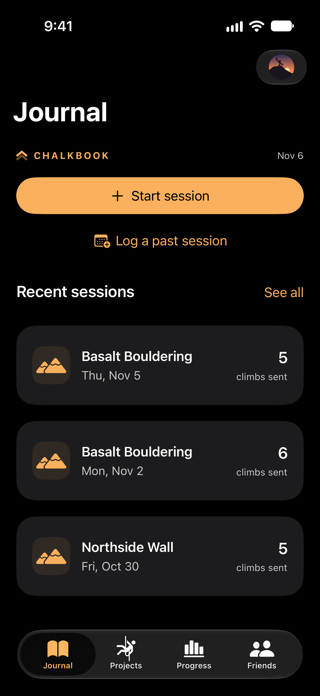
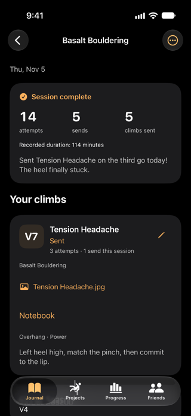
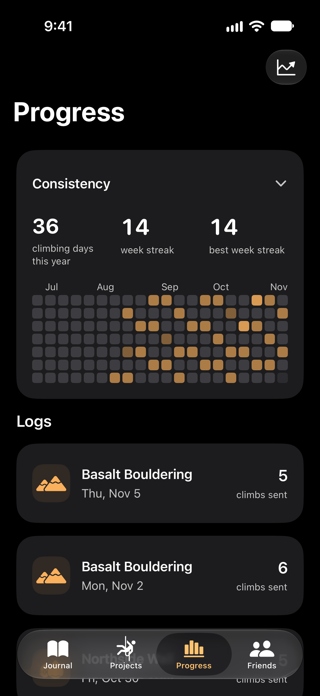

# Hi, I'm Shreyas 👋

CS student at UC Berkeley. I build iOS apps and machine learning projects, and I'm most excited about AI for science, especially computational biology.

  

  
  
  
  

## Projects

###  [Chalkbook](https://github.com/FROZENPOP/chalkbook)

A bouldering journal for iPhone: log sessions, track projects, see your progress. SwiftUI, SwiftData and a Supabase backend.

  
  
  

### 🧬 [CRISPR guide RNA efficiency](https://github.com/FROZENPOP/CRISPR_TARGET_NN)

CNN and GRU models in TensorFlow and Keras that predict a guide RNA's editing efficiency, evaluated against Microsoft's Azimuth baseline (Azimuth still came out ahead). Independent research through Polygence (2024–25), written up as a draft paper.

### 🩺 [MedQuAD Bot](https://github.com/FROZENPOP/MEDQUAD_BOT)

A medical Q&A chatbot I built as a summer intern at SciEncephalon AI (2025). It searches 15,426 NIH question-answer pairs with FAISS and has an LLM write the answer.

### ⚡ Verbatim

Faster summarization for healthcare AI, built with my teammate Arnav in four days at SF Tech Week (October 2026). I did the benchmarks, evaluation and pitch. In our prototype: up to 4.3x faster, with outputs identical to standard decoding.

  
  

